<div align="center">

# Glucose Twin

### A physiology-informed digital twin that forecasts type 2 diabetes glucose spikes,<br>and states exactly what its evidence does and does not prove.

**[Live Workstation Demo: t2d-glucose-digital-twin.akshay.blitz.cloud](https://t2d-glucose-digital-twin.akshay.blitz.cloud/)**

[](https://t2d-glucose-digital-twin.akshay.blitz.cloud/)
[](#tests-and-verification)
[](#tests-and-verification)
[](LICENSE)
[](#limitations-and-intended-use)

[Live demo](https://t2d-glucose-digital-twin.akshay.blitz.cloud/) · [Submission checklist](#submission-checklist) · [What it does](#what-it-does) · [Architecture](#architecture) · [Evidence](#evidence) · [Quick start](#quick-start) · [Datasets](#datasets-and-licences) · [Limitations](#limitations-and-intended-use)

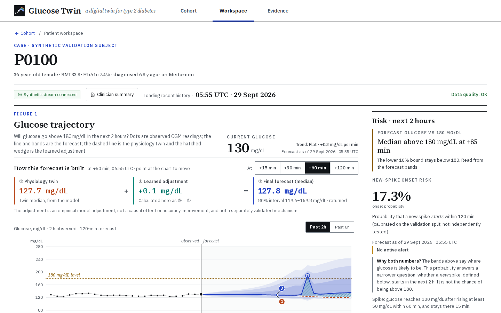

<sub>The patient workspace, captured from the production build on this branch with a synthetic validation subject. Dots: observed CGM. Dashed: physiology twin. Hatched: learned adjustment. Bands: forecast quantiles.</sub>

</div>

> [!IMPORTANT]
> **Research prototype. Not for clinical decisions.** The application replays a synthetic cohort. It has no medical-device status and no clinical validation. Every metric below names its data, its denominator and its evidence tier.

## In 30 seconds

- **The problem.** After-meal glucose spikes above 180 mg/dL drive long-term harm in type 2 diabetes, and CGM alarms usually fire only once the spike has started.
- **What we built.** A clinical workstation around a hybrid twin. A physiological model (UKF-tracked) gives the baseline; a learned residual and a calibrated hazard head give a 2-hour forecast and a spike-onset risk. Around it: ward triage, What-if meal and activity scenarios, a printable clinician summary and a FHIR R4 export.
- **What we proved, and what we did not.** On a locked, preregistered real-patient evaluation, the hybrid forecasts better than persistence at 60 minutes. It warns of only **6.9% of spikes ≥30 min ahead**. Two later preregistered checks on unused cohorts did **not** confirm an early-warning improvement over simple trend rules. A new candidate policy is exploratory, and its confirmation protocol is frozen but not yet run.

| Evidence tier | Status | Where |
|---|---|---|
| Locked real-patient evaluation | ✅ run once, immutable | [`docs/evidence/real_data/RESULTS.md`](docs/evidence/real_data/RESULTS.md) |
| External check 1: Hall 2018 | ❌ not confirmed | [`docs/evidence/external_hall/RESULTS.md`](docs/evidence/external_hall/RESULTS.md) |
| External check 2: AZT1D + Broll | ❌ not met | [`docs/evidence/external_v2/RESULTS.md`](docs/evidence/external_v2/RESULTS.md) |
| Candidate C2 (risk-gated trend) | 🧪 exploratory, CI includes 0 | [`docs/evidence/fa_controller/README.md`](docs/evidence/fa_controller/README.md) |
| AI-READI confirmation | ⏳ protocol frozen, awaiting data access | [`docs/evidence/aireadi_confirmation/PREREGISTRATION.md`](docs/evidence/aireadi_confirmation/PREREGISTRATION.md) |

## Submission checklist

| Challenge item | Where |
|---|---|
| Team details | [Submission](#submission): Akshaya R · Nikhil VS |
| College / institution | [Submission](#submission): BGS College of Engineering and Technology · East West Institute of Technology |
| Project title | Glucose Twin (repository: T2D Glucose Digital Twin) |
| Problem statement and healthcare use case | [Problem and healthcare use case](#problem-and-healthcare-use-case) |
| What makes it a digital twin | [What makes it a digital twin](#what-makes-it-a-digital-twin) |
| Technical stack | [Technical stack](#technical-stack) |
| AI/ML model and framework details | [Model details](#model-details) |
| Results and evidence | [Evidence](#evidence) · [claim–evidence ledger](docs/submission/CLAIM_EVIDENCE_LEDGER.md) |
| Demo video | [YouTube: youtu.be/arTnv1yWy1E](https://youtu.be/arTnv1yWy1E) |
| Open-source licence | [Apache-2.0](#license) |
| Architecture diagram | [Architecture](#architecture) · [`architecture.pdf`](docs/architecture/architecture.pdf) |
| Presentation | [`presentation.pdf`](docs/presentation/presentation.pdf) · [`presentation.pptx`](docs/presentation/presentation.pptx) |
| Public access | Live demo: [`t2d-glucose-digital-twin.akshay.blitz.cloud`](https://t2d-glucose-digital-twin.akshay.blitz.cloud/) · Public repository. Run locally with [Quick start](#quick-start) |
| Ethics, privacy and security | [Ethics, privacy and security](#ethics-privacy-and-security) |

## Problem and healthcare use case

- **Condition:** type 2 diabetes and prediabetes.
- **Adverse event:** a new glucose spike above 180 mg/dL within the next 2 hours, predicted while glucose is still in range.
- **Why it matters:** repeated after-meal spikes are linked to long-term complications. A CGM shows where glucose *is*; a clinician needs to know where it is *going*, early enough to act.
- **Use case:** a care team remotely monitoring patients who wear a CGM. They open the ward view, see who needs attention in the next two hours and why, and test a change (a meal, a walk) on the patient's twin before advising. They then hand over a one-page summary or a FHIR record.

## What makes it a digital twin

- **A physiological state, kept in step with the patient.** An unscented Kalman filter (UKF) updates a glucose–insulin–gut model with every CGM reading. The forecast starts from that state, not from a statistical pattern alone.
- **Personalised from the record.** EHR context (age, BMI, HbA1c, diabetes duration, medication classes) sets the twin's priors. The calibrated twin parameters feed the network as static context.
- **It can be asked "what if".** Scenario inputs (a meal, activity, a skipped usual meal) are run through the same twin and network from the same moment. The interface shows the twin's own response separately from the learned adjustment.
- **It says when it does not know.** Quantile bands, out-of-training-range warnings, data-quality states and refusals (for example medication changes) are part of every output.
- **Limit, stated plainly:** online per-patient parameter refitting was tested and did not beat a LightGBM baseline ([report §5](docs/evidence/operating_point/README.md)), so the twin's parameters are not refitted online.

## What it does

| | |
|---|---|
| 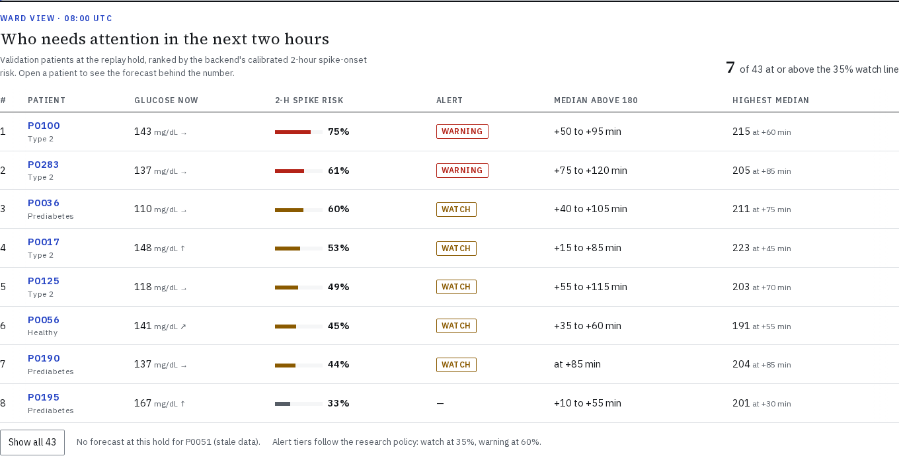 | **Ward triage.** Ranks every validation patient by the backend's calibrated 2-hour spike-onset risk at the replay hold. Shows current glucose, alert tier, and when and how high the forecast median crosses 180 mg/dL. Patients the service declines to forecast are listed by name, never silently ranked. |
| 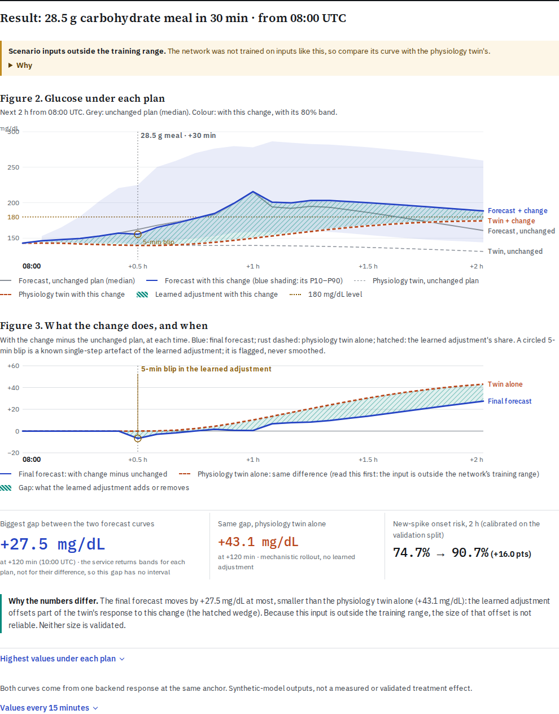 | **What-if, on the same time axis.** Add a meal, activity, or a skipped usual meal. The backend re-runs the twin and the network from the forecast moment. The result separates the twin's response from the learned adjustment and flags inputs outside the training range. Medication changes are refused rather than guessed. |
| 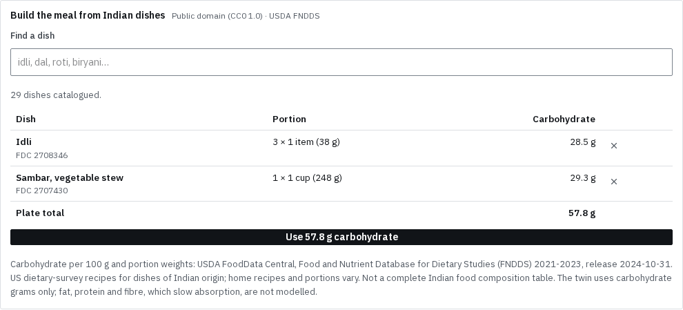 | **Indian meals with provenance.** Build a plate from 29 dishes of Indian origin in USDA FNDDS (public domain), by survey portion or weighed grams. Every dish keeps its FDC id. Only carbohydrate grams reach the model, and the interface says so. |
| 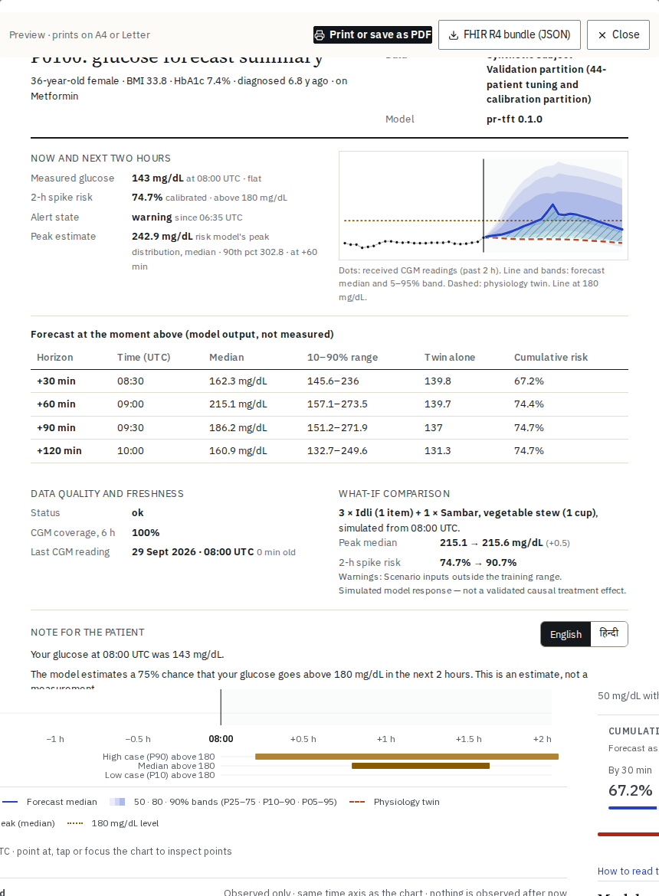 | **Clinician summary and FHIR R4.** A one-page printable summary covers measured versus forecast glucose, risk, data quality and the last scenario. It includes a patient note in English or Hindi; the Hindi is marked as not yet reviewed by a native-speaking clinician. The FHIR R4 Bundle export validates against the official HL7 R4 JSON schema in tests, with semantic checks on references, LOINC and UCUM codes, and a test-data label. |
|  | **Evidence inside the product.** The Evidence page separates proven capabilities, exploratory candidates and independently confirmed results (currently none). It shows the failed external checks with their numbers. A test keeps every figure in sync with the committed result files. |

## Architecture

The product and the real-patient research pipeline are separate systems. The **workstation** serves a synthetic cohort through the hybrid twin. The **research pipeline** produced the locked real-patient evaluation and the external checks; it is not served.

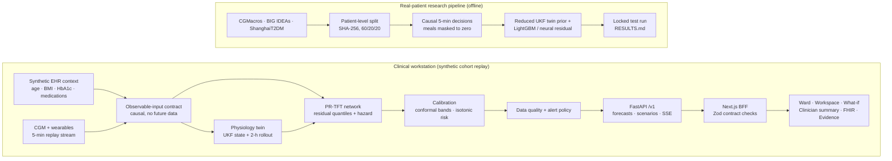

### Model details

<details>
<summary><b>PR-TFT hybrid (served) and the real-patient research models</b></summary>

**Served model: PR-TFT, physiology-residual temporal fusion transformer** (`backend/train_pr_tft.py`, run `runs/pr_tft_ablation_arm_d`)

| Component | Implementation |
|---|---|
| Physiology prior | UKF-tracked glucose–insulin model with a two-compartment gut ("S3" mode, basal from the first CGM reading), rolled out 120 min under "no new meal" and "habitual meal" |
| Static encoder | Variable selection over EHR context plus calibrated twin parameters, giving the TFT context vectors |
| Past encoder | Variable selection over 144 past steps (12 h), then a 2-layer LSTM |
| Future decoder | Variable selection over 24 known-future steps (time, habit prior, twin scenarios), then an LSTM |
| Temporal fusion | Static enrichment, causal interpretable multi-head attention (4 heads, d_model 96), gated residual networks |
| Heads | Residual quantiles at 5/10/25/50/75/90/95% (monotone by construction), per-bin spike hazard, peak-glucose quantiles |
| Loss | Risk-weighted pinball + focal hazard (γ 2.0, α 0.75) + median-residual and hazard-consistency terms + peak pinball |
| Training | Seed 20260930, AdamW lr 1e-3, batch 256, up to 30 epochs with early stopping (patience 4), PyTorch Lightning |
| Calibration | Saved conformal interval adjustment (80% level) and isotonic hazard calibration |

**Real-patient research models** (`docs/evidence/real_data/develop.py`)
- Locked evaluation: reduced UKF twin prior plus a LightGBM / neural residual ensemble, with isotonic hazard calibration.
- Exploratory work: LightGBM hazard models with daily-routine features, calibrated on patient-grouped OOF predictions.
- No meal inputs are used (masked to zero).
</details>

<details>
<summary><b>Prediction and early-warning pipeline</b></summary>

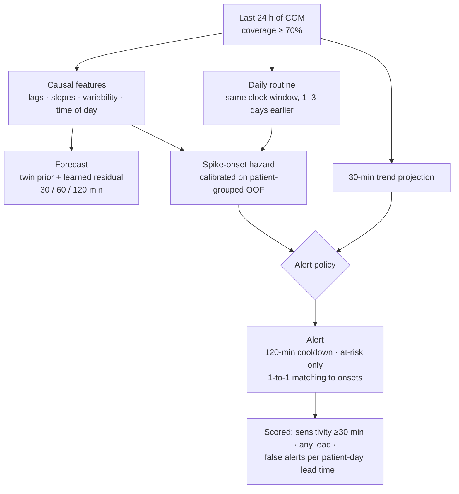

**Research pipeline:** a spike onset is the start of a run of at least 15 min at or above 180 mg/dL. **Served application:** it also requires a rise of at least 50 mg/dL within the previous 60 min. In both, warnings count only 5–120 min before an onset, alerts are raised only while glucose is below 180 mg/dL, and each alert can claim at most one onset.
</details>

<details>
<summary><b>Evaluation design: isolation, selection, freezing</b></summary>

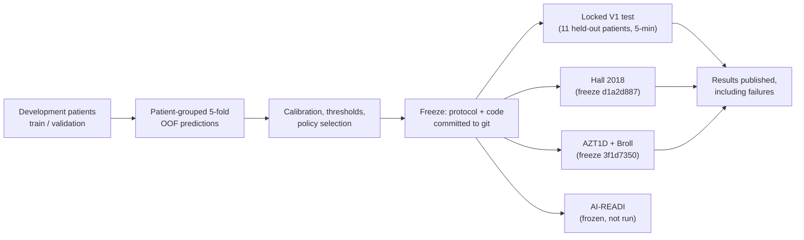

Test records are loaded only by the single authorized run. External cohorts are read once, after the freeze commit. A later amendment is allowed only for a loading error and must be committed before any outcome exists (one occurred, in AZT1D, and is documented).
</details>

## Evidence

### Locked real-patient evaluation

Preregistered ([`PREREGISTRATION.md`](docs/evidence/real_data/PREREGISTRATION.md), [`AMENDMENT_001.md`](docs/evidence/real_data/AMENDMENT_001.md)) and run once. It is **immutable**: none of the exploratory work below changes it. The cohort has 161 nominal participants across three datasets. The 5-min headline metrics come from **11 held-out test patients**. The 20 ShanghaiT2DM test patients are not estimable at 15-min cadence.

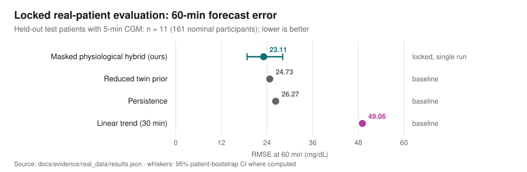

| Metric (held-out test, point estimate) | Value | 95% CI (patient bootstrap) |
|---|---|---|
| RMSE at 30 / 60 / 120 min | 16.77 / **23.11** / 26.44 mg/dL | 60 min: 18.75–28.12 |
| Spike onsets warned ≥30 min ahead | **6.9%** | 0.0–13.9 |
| Alert precision | 65.5% | — |
| False alerts per patient-day | 0.11 | 0.02–0.23 |
| Median warning lead time | 10 min | none (the code reports a fixed ±5 min band, not a CI) |
| Leave-one-dataset-out RMSE at 60 min | CGMacros 23.97 · BIG IDEAs 22.14 mg/dL | — |

<details>
<summary>Why <code>RESULTS.md</code> shows 23.04 and 6.0%</summary>

Both locked files come from one run, but they print different statistics:
- `results.json` and the `RESULTS.md` horizon list give **point estimates** on the full test set, used here: 23.11 mg/dL and 6.9%.
- The `RESULTS.md` headline table gives the **mean of 2,000 patient-bootstrap resamples**: 23.04 and 6.0%.

The 95% intervals are identical in both. The code traces are in [`LOCKED_RESULTS_RECONCILIATION.md`](docs/submission/LOCKED_RESULTS_RECONCILIATION.md). Both locked files are unchanged, and the chart above is generated from `results.json`.
</details>

### External checks (preregistered, on cohorts unused in development)

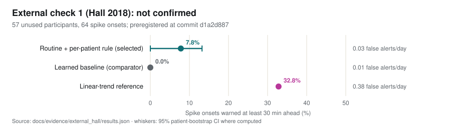

**Hall 2018: not confirmed.** The routine model beat the learned baseline by +7.8 points [0.0, +13.2], but the preregistered rule needed the lower bound above zero. A simple linear-trend reference did better than both learned policies on this mostly normoglycaemic cohort.

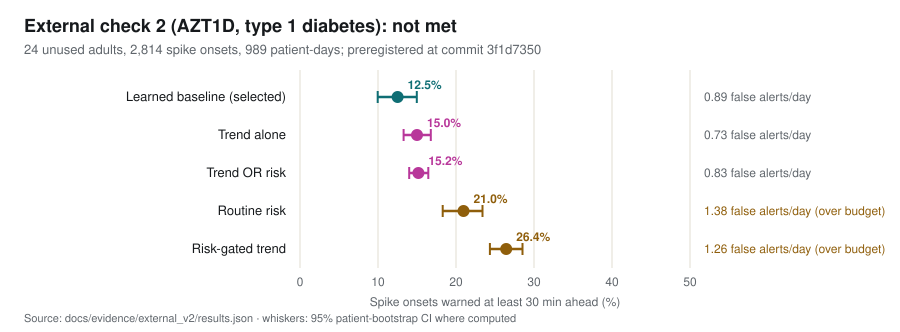

**AZT1D (type 1 diabetes, closed-loop insulin): not met.** The learned policy scored −2.5 points [−6.4, +1.4] against the trend rule and −2.7 [−5.7, +0.5] against trend-or-risk. Broll (5 adults with type 2 diabetes) is descriptive only: persistence had the lowest RMSE at every horizon.

### Exploratory candidate and pending confirmation

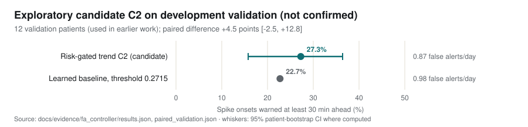

- **Candidate C2** is a risk-gated trend policy, with thresholds chosen on training data so that the *worst* patient fold stays within 1 false alert/day. It is the first policy here to stay within budget on new patients. The gain is not established: +4.5 points, with a CI from −2.5 to +12.8, on 12 validation patients used in earlier work.
- **AI-READI confirmation** covers type 2 participants in AI-READI's test split and is frozen in [`aireadi_evaluate.py`](docs/evidence/aireadi_confirmation/aireadi_evaluate.py), tested on a synthetic release. **It has not been run**: data access is not yet approved.

<details>
<summary><b>Every exploratory experiment, including the null results</b></summary>

All of these use training and validation patients only. None touches the locked test partition.

| Question | Result | Report |
|---|---|---|
| Does a budget-matched threshold help? | Small gain inside the CI | [`operating_point/README.md` §1](docs/evidence/operating_point/README.md) |
| Do logged meals help? | Precision and lead up; ≥30-min sensitivity inside the CI | §2 |
| An explicit ≥30-min target? | Rejected (worse) | §3 |
| The patient's daily routine? | Ranking improves: training OOF +5.4 points [+0.7, +10.1] | §3 |
| Does the routine threshold transfer? | No (1.55 false alerts/day); per-patient rate control holds the budget but loses the gain | §4 |
| Online per-patient forecast personalization? | Does not beat LightGBM | §5 |
| False-alert feedback controller? | Null (1.09/day) | [`fa_controller/README.md`](docs/evidence/fa_controller/README.md) |
</details>

Every claim, with its artifact and promotion rule, is in the [claim–evidence ledger](docs/submission/CLAIM_EVIDENCE_LEDGER.md).

## Technical stack

| Layer | Tools |
|---|---|
| Frontend | Next.js 16 (App Router), React 19, TypeScript, Tailwind CSS 4, D3 scales, lucide icons |
| Backend | Python 3.12, FastAPI, Uvicorn, Pydantic v2, server-sent events |
| Modelling | PyTorch + Lightning (PR-TFT), NumPy/JAX UKF twin, LightGBM, scikit-learn (isotonic calibration) |
| Contracts and interoperability | JSON Schema contracts compiled to TypeScript, Zod validation, Ajv (FHIR R4 schema tests), HL7 FHIR R4 |
| Quality | Jest + Testing Library + jest-axe, pytest, Playwright browser checks |

## Quick start

**Requirements:** Node.js ≥ 20.9, Python 3.12, Git LFS (model weights and twin state).

```bash
git clone https://github.com/AkshayAlgoX/T2D-Glucose-Digital-Twin.git
cd T2D-Glucose-Digital-Twin && git lfs pull

# Backend: synthetic-cohort inference service
python3 -m venv .venv && source .venv/bin/activate
pip install -r backend/requirements.txt --extra-index-url https://download.pytorch.org/whl/cpu
python -B backend/serve_pr_tft.py --run-dir runs/pr_tft_ablation_arm_d --host 127.0.0.1 --port 8001

# Frontend (second terminal)
npm ci
echo "BACKEND_URL=http://127.0.0.1:8001" > .env.local
npm run build && npx next start -p 3000
```

Open `http://localhost:3000/cohort` and choose a patient from the ward. Use `localhost`, not `127.0.0.1`.

<details>
<summary><b>API entry points</b></summary>

| Layer | Endpoint | Purpose |
|---|---|---|
| Backend | `GET /v1/health` | Liveness |
| Backend | `GET /v1/subjects` | Served subjects (the sealed test split is never listed) |
| Backend | `POST /v1/forecasts` | Forecast, spike risk and optional scenarios at a pinned moment |
| Backend | `GET /v1/subjects/{id}/twin` | Twin card |
| Backend | `GET /v1/subjects/{id}/stream` | Server-sent replay stream |
| Frontend BFF | `/api/subjects`, `/api/forecast`, `/api/ward`, `/api/patients/[id]/stream`, `/api/patients/[id]/twin` | Proxies with contract validation |

Contracts live in `backend/contracts/v1/*.json` and are compiled into `src/types` by `npm run prebuild`. `npm run build` fails if they drift.
</details>

<details>
<summary><b>Reproducing the evidence</b></summary>

```bash
python docs/assets/readme/make_charts.py      # regenerates every README chart from committed results

# Research scripts need the licensed raw datasets under data/real (not redistributed):
python docs/evidence/operating_point/routine_target_arms.py --data-dir data/real
python docs/evidence/fa_controller/develop_controller.py   --data-dir data/real
```

Seeds are fixed at `20260930`. External-check inputs are verified by the sha256 values recorded in their preregistrations.
</details>

## Tests and verification

```bash
npm test -- --runInBand --silent                     # 48 suites, 450 tests
RUN_DIR=runs/pr_tft_ablation_arm_d pytest backend/tests/ -q   # 162 passed (without RUN_DIR: 134 passed, 2 skipped)
npx tsc --noEmit && npm run build                     # types, contract-drift check, production build
```

- **Frontend:** contracts, safety invariants, stream recovery, accessibility (jest-axe), FHIR schema and semantics, and evidence-number drift.
- **Backend:** causality, sealed-split access, twin counterfactual plausibility, alert-policy mechanics, and the AI-READI harness on synthetic data.
- **Browser:** the ward → patient → What-if → summary → FHIR flow is checked on desktop and at 390 px.

## Datasets and licences

| Dataset | Role | Licence |
|---|---|---|
| Synthetic cohort (`backend/synthetic_v2`) | Served application | Project, Apache-2.0 |
| CGMacros (PhysioNet 1.0.0) | Real-patient development and locked test | CC BY-NC-SA 4.0 (not redistributed) |
| BIG IDEAs (PhysioNet 1.1.3) | Real-patient development and locked test | ODC-By 1.0 (not redistributed) |
| ShanghaiT2DM | Real-patient development; test not estimable | CC BY 4.0 (not redistributed) |
| Hall et al. 2018, *PLoS Biol* | External check 1 | CC BY 4.0 (not redistributed) |
| AZT1D (Mendeley Data) · Broll (iglu) | External check 2 | CC BY 4.0 · GPL-2 (not redistributed) |
| USDA FoodData Central FNDDS 2021–2023 | Meal catalogue | Public domain (CC0) |
| HL7 FHIR R4 JSON schema | Test fixture | HL7 FHIR licence (CC0) |

## Ethics, privacy and security

- **No patient data are served.** The application replays a synthetic cohort. FHIR exports carry the HL7 `HTEST` (test data) security label.
- **Licensed real data stay local.** CGMacros, BIG IDEAs, ShanghaiT2DM and the external cohorts are used under their licences and never committed (see [Datasets](#datasets-and-licences)).
- **The sealed test split cannot leak through the API.** Its subjects are never listed, and every request for them returns the same `404` as an unknown id (`backend/tests/test_sealed_split_access.py`).
- **No secrets are tracked.** A repository scan found no credentials. Backend data endpoints accept an optional `Authorization` header token, and the browser reaches them only through the contract-validating Next.js server layer.
- **Honest outputs.** Missing readings are never shown as zero. Scenario results are labelled as model responses. Unvalidated translations are marked as such.

## Limitations and intended use

- **Research only.** Not a medical device. Not for diagnosis, dosing or treatment decisions.
- **The served application replays a synthetic cohort.** Its realism check (Gate 3) failed. Real-patient results come from the separate research pipeline.
- **Early warning is the weak point.** It was 6.9% at ≥30 min in the locked evaluation, and no improvement over simple trend rules has been shown on unused data.
- **What-if results are model responses, not validated causal effects.** Meal inputs are outside the network's training range, and only carbohydrate grams are modelled.
- **Hindi text is unreviewed** by a native-speaking clinician.
- **FHIR checks are partial.** Invariants, profiles and terminology bindings are not checked.

## Submission

| Item | Location |
|---|---|
| Team | **T2D Digital Twin Team**: Akshaya R (BGS College of Engineering and Technology) · Nikhil VS (East West Institute of Technology) |
| Repository | [github.com/AkshayAlgoX/T2D-Glucose-Digital-Twin](https://github.com/AkshayAlgoX/T2D-Glucose-Digital-Twin) |
| Architecture document | [`docs/architecture/architecture.pdf`](docs/architecture/architecture.pdf) (submission snapshot; the diagrams above reflect this branch) |
| Presentation | [`docs/presentation/presentation.pdf`](docs/presentation/presentation.pdf) (14-page submission snapshot) · [`docs/presentation/presentation.pptx`](docs/presentation/presentation.pptx) (14-slide editable presentation deck) |
| Demo reproduction guide | [`docs/demo/DEMO_SCRIPT_20MIN.md`](docs/demo/DEMO_SCRIPT_20MIN.md) (planning and reproduction guide; not a transcript of the recorded video) |
| Demonstration video | [YouTube: youtu.be/arTnv1yWy1E](https://youtu.be/arTnv1yWy1E) |
| Claim–evidence ledger | [`docs/submission/CLAIM_EVIDENCE_LEDGER.md`](docs/submission/CLAIM_EVIDENCE_LEDGER.md) |

## License

Apache License 2.0. See [`LICENSE`](LICENSE) and [`NOTICE`](NOTICE). Copyright 2026 Akshaya R and Nikhil VS (T2D Digital Twin Team). Third-party datasets keep their own licences (above) and are not redistributed. npm and pip dependencies keep their upstream licences.
